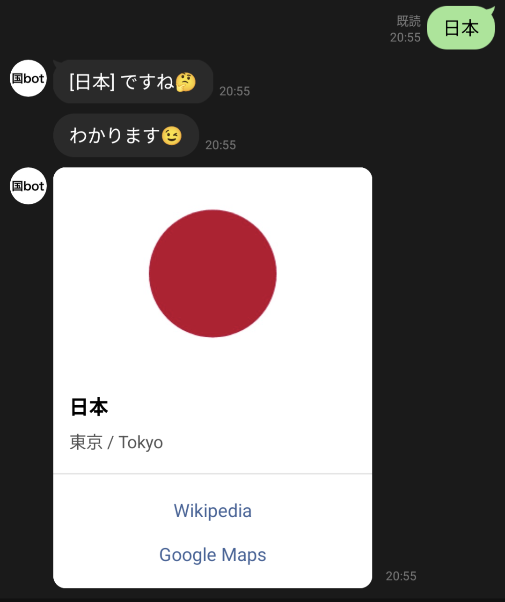
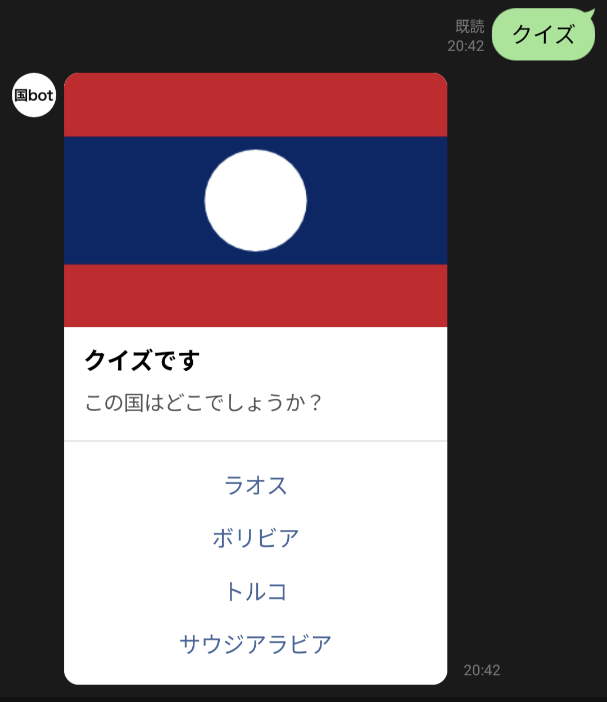

# line_country_bot_go

国名を送ると国旗と首都を返し、国旗 4 択クイズも出せる LINE bot です。
Go で書かれ、Cloudflare Workers（Go → WebAssembly）の無料プランで動きます。
サーバーの運用や LINE SDK は不要で、国データと国旗はスクリプトを再実行するだけで更新できます。

## 友だち追加

次のリンクを開くか、QR コードを LINE で読み取って友だちに追加すると試せます。友だちになってください。

https://line.me/R/ti/p/@aed1744s


## できること

 

| 送るもの | 返ってくるもの |
|---|---|
| 国名（例: 「日本」「アメリカ」「France」） | 「[日本] ですね🤔」「わかります😀」と、国旗・首都（日本語 / 英語）・Wikipedia と Google Maps へのボタン |
| 見つからない国名 | 「[〇〇] ですね🤔」「む、むむっ、、わかりませんでした😢」 |
| 「クイズ」「quiz」 | 国旗を見せて 4 択で国名を当てるクイズ |
| クイズの回答ボタン | 正誤。正解なら国の詳細と「もう一度やりますか？」（はい / いいえ） |
| 「いいえ」 | 返信なし（クイズの終了） |
| 「君の名は」「who」 | 自己紹介（プロフィールを設定したときだけ。未設定なら国名として検索） |
| スタンプや画像などテキスト以外 | 「テキストメッセージ以外わからないです」とスタンプ |

国名は前後や途中の空白（全角を含む）を無視し、英字は大文字小文字を区別せずに、表示名・日本語の別名・英語名と完全一致で検索します。

## 必要なもの

- Go 1.27.3（`go.mod` の `go` ディレクティブ。手元の Go が古くても `GOTOOLCHAIN=auto` で自動的に取得されます）
- Node.js と npm（wrangler を devDependencies として入れます）
- TinyGo 0.43.0 と Binaryen（wasm-opt）version_133（wasm のビルドに使います。`scripts/install-tinygo.sh` で入れます。仕組みは [docs/development.md](docs/development.md) を参照してください）
- Cloudflare アカウント（Workers 無料プラン）
- LINE 公式アカウントと Messaging API チャネル（作り方は下の「デプロイ」を参照してください）

## 動かすまで

```sh
npm ci                           # wrangler を入れる
bash scripts/install-tinygo.sh   # TinyGo と wasm-opt を .tools/ に入れる
go test -race ./...              # ホストでテスト
npm run build                    # TinyGo で wasm をビルドする
```

整形の確認、TinyGo でのテスト、サイズの確認、ローカル疎通、CPU 時間の計測などのほかのコマンドは [docs/development.md](docs/development.md) にあります。

## デプロイ

先に LINE 側でチャネルを用意し、チャネルシークレットとチャネルアクセストークンを控えておきます。

1. LINE 公式アカウントを作成する
2. LINE Official Account Manager の設定から Messaging API を有効にする（チャネルが LINE Developers コンソールに作られます）
3. LINE Developers コンソールでチャネルシークレットを確認し、チャネルアクセストークン（長期）を発行する

`npx wrangler secret put` を実行すると値を聞かれるので、控えたチャネルシークレットとチャネルアクセストークンをそれぞれ入力します。

```sh
npx wrangler login
npx wrangler secret put CHANNEL_SECRET
npx wrangler secret put CHANNEL_ACCESS_TOKEN
# 必要なら wrangler.jsonc の vars（PUBLIC_BASE_URL や PROFILE_*）を編集
npx wrangler deploy
```

`npx wrangler deploy` はその場で TinyGo のビルド（`npm run build`）を作ってから載せるので、先に `bash scripts/install-tinygo.sh` を済ませておきます。

TinyGo のビルドで問題が出たときは、次のコマンドで通常の Go のビルドに戻せます。

```sh
WASM_BUILD=go npx wrangler deploy
```

仕組みは [docs/development.md](docs/development.md) の「デプロイの仕組みと切り戻し」を参照してください。

設定は `CHANNEL_SECRET` と `CHANNEL_ACCESS_TOKEN` が必須で、ほかは任意です。全項目と既定値は [docs/configuration.md](docs/configuration.md) を参照してください。

デプロイ後、LINE 側を設定します。

1. LINE Developers コンソールの Messaging API 設定で、Webhook URL に `https://<worker のホスト名>/webhook` を設定する
2. 「Webhook の利用」をオンにする
3. 「検証」ボタンで成功（200）になることを確かめる
4. LINE Official Account Manager の応答設定で「応答メッセージ」をオフにする（オンのままだと定型の自動応答が bot の返信と一緒に届きます）

動作は `npx wrangler tail` で確認できます。ログに出す内容は [docs/development.md](docs/development.md) の「ログ」を参照してください。

## ドキュメント

- [docs/architecture.md](docs/architecture.md): 全体の構成、リクエストの時間配分、パッケージとリポジトリの構成、ビルドとデプロイの流れ、制限事項と設計上の決まり
- [docs/configuration.md](docs/configuration.md): 設定項目の一覧と既定値、自己紹介とローディング表示の条件、LINE チャネル側の設定
- [docs/development.md](docs/development.md): 環境構築、コマンド一覧、ビルドの仕組み、ローカル疎通、CPU 時間の計測、デプロイの仕組みと切り戻し、ログ
- [docs/data-update.md](docs/data-update.md): 国データと国旗の更新手順、生成ファイルの扱い、生成が失敗したときの補正

## 出典とライセンス

- コード: [MIT License](LICENSE)
- 国データ: [Wikidata](https://www.wikidata.org/)（CC0 1.0）
- 国旗画像: [Flagpedia](https://flagpedia.net/)（[flagcdn.com](https://flagcdn.com/)、パブリックドメイン）

詳しくは [NOTICE](NOTICE) を参照してください。
