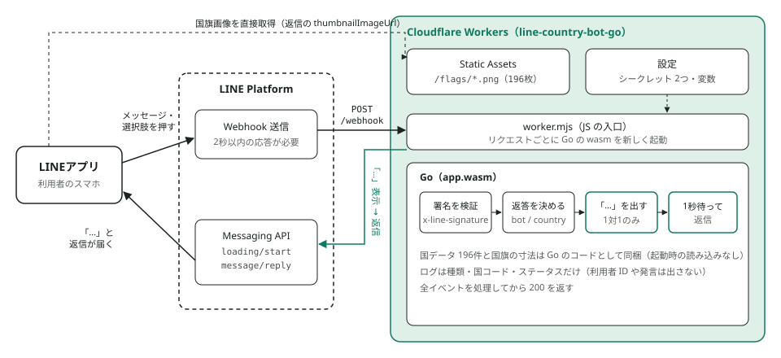
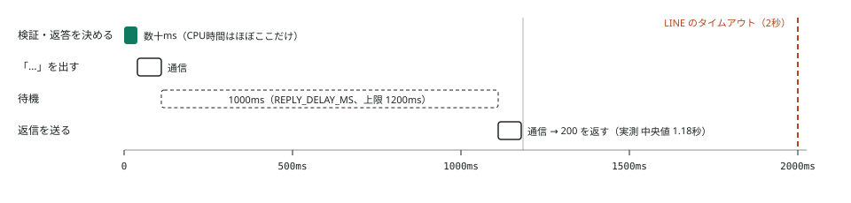
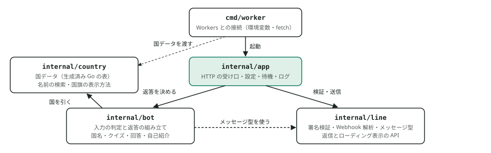
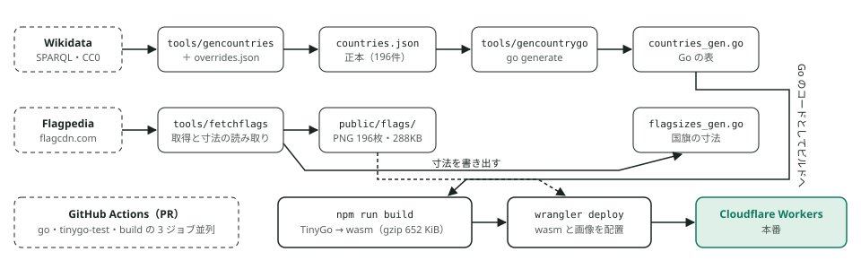

# アーキテクチャ

LINE で国名を送ると国旗と首都を返し、国旗の 4 択クイズも出せる bot です。サーバーは持たず、Cloudflare Workers 上で Go を WebAssembly として動かしています。国データと国旗画像はビルド前に生成し、プログラムに同梱しています。

| 指標 | 値 | メモ |
|---|---|---|
| LINE への応答時間（本番） | 中央値 1.16 秒 | 上限 2 秒（最大 1.32 秒） |
| CPU 時間（本番） | 中央値 30ms（16〜97ms） | 待ち時間は含まない。立ち上がり直後の重いリクエストは中央値 56ms、それ以外は 18.5ms |
| wasm サイズ（gzip 後） | 652 KiB | TinyGo でビルド。無料プランの上限 3MB |
| 国データ / 国旗 | 196 / 196 | Wikidata（CC0）/ Flagpedia（パブリックドメイン） |

数値は 2026-10-25 時点の計測です。本番の値は TinyGo のビルドをデプロイしたあと、実機から送った 31 件の `wrangler tail` の記録から出しています。

## 全体の構成：メッセージが返信になるまで

LINE アプリから届いたメッセージは、LINE Platform から Webhook で Workers に渡ります。Workers はリクエストのたびに Go の wasm を起動し、返答を決めてから、Messaging API に「…」の表示と返信を送ります。国旗画像は、返信に含めた URL を使って LINE アプリが Workers の静的ファイルから直接取得します（破線）。

## 1 回のリクエストの時間配分

待機は Webhook への応答を返す前に行います。使っているライブラリ workers-go v0.36 では、応答を返したあとに待つ処理が不安定なためです。待っている時間は CPU 時間に数えられません。待機の上限を 1.2 秒にして、通信と処理を足しても LINE の 2 秒の制限に収めています。グループや複数人のトークでは「…」を出せないので、待たずに返信します。

## Go のパッケージ構成

| パッケージ | 役割 |
|---|---|
| `cmd/worker` | Workers との接続（環境変数の読み取りと fetch）。Workers に依存するのはここだけ |
| `internal/app` | HTTP の受け口、設定、待機、ログ |
| `internal/bot` | 入力の判定と返答の組み立て（国名・クイズ・回答・自己紹介） |
| `internal/line` | 署名検証、Webhook の解析、メッセージ型、返信とローディング表示の API |
| `internal/country` | 国データ（生成済みの Go の表）、名前の検索、国旗の表示方法 |

`cmd/worker` 以外は、手元で `go test` できます。外部とのやり取りは「HTTP 送信」と「環境変数の読み取り」の 2 か所に絞り、テストでは差し替えています。

## ビルドとデプロイの流れ

国データと国旗は、ツールを手元で実行して作り、生成物をリポジトリに置きます。Wikidata への問い合わせはビルドのたびには行いません。生成物がずれたらテストが失敗し、再生成のコマンドを示します。wasm は TinyGo でビルドします（`npm run build`）。通常の Go よりファイルが小さく、リクエストごとの読み込みと初期化が軽いためです。TinyGo と wasm-opt は `scripts/install-tinygo.sh` が公式配布物を hash 検証して入れ、手元と CI で同じ版を使います。通常の Go のビルド（`npm run build:go`）も比較と退避用に残しています。デプロイは手元から `wrangler deploy` で行います（CI は PR での確認だけ）。

| 生成物 | 作り方 |
|---|---|
| `internal/country/data/countries.json` | `go run ./tools/gencountries`（Wikidata の SPARQL と `tools/gencountries/overrides.json`） |
| `internal/country/countries_gen.go` | `go generate ./internal/country`（countries.json から生成） |
| `public/flags/*.png`、`internal/country/flagsizes_gen.go` | `go run ./tools/fetchflags`（Flagpedia から取得し、寸法を書き出す） |
| `build/app.wasm`、`build/worker.mjs`、`build/wasm_exec.js` | `npm run build`（TinyGo） |

## 設定

| 名前 | 種類 | 内容 |
|---|---|---|
| `CHANNEL_SECRET` | シークレット | Webhook の署名検証に使う |
| `CHANNEL_ACCESS_TOKEN` | シークレット | 返信とローディング表示の API に使う（長期トークン） |
| `WEBHOOK_PATH` | 変数 | 受け口のパス。既定 `/webhook` |
| `REPLY_DELAY_MS` | 変数（任意） | 返信前の待機。既定 1000、上限 1200、0 で即時 |
| `PUBLIC_BASE_URL` | 変数（任意） | 国旗画像の URL の基点。未設定ならリクエストのホストから作る |
| `LINE_API_BASE_URL` | 変数 | 既定 `https://api.line.me`（ローカル確認ではモックに向ける） |
| `PROFILE_*` | 変数（任意） | 「君の名は / who」で出す自己紹介。空なら無効 |

LINE チャネルの「セキュリティ設定」の IP アドレス制限は空にしています。Workers は送信元の IP アドレスが固定されないためです。

## 今後の検討事項

| 項目 | 状況 |
|---|---|
| CPU 時間 | 本番の中央値 30ms。無料プランの目安 10ms は超えているが、打ち切りは出ていない。リクエストの約半分は立ち上がり直後で重い（46〜97ms）。TinyGo の最適化オプション（`-gc=leaking` など）が次の候補 |
| TinyGo | 採用済み。Go でビルドしていたとき（11 件）と比べて、重いリクエストの中央値は 83 → 56ms、それ以外は 21.5 → 18.5ms |
| JSON 生成の軽量化 | 返信と入力中表示の本文は手書きのエンコーダで生成済み。Webhook の受信（`json.Unmarshal`）は未対応で、置き換えるなら fuzz テストと一緒に行う |
| 開発用ツールの脆弱性 | `npm audit` が wrangler の依存（undici）で 3 件。bot 本体には含まれない |
